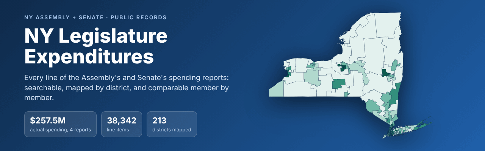
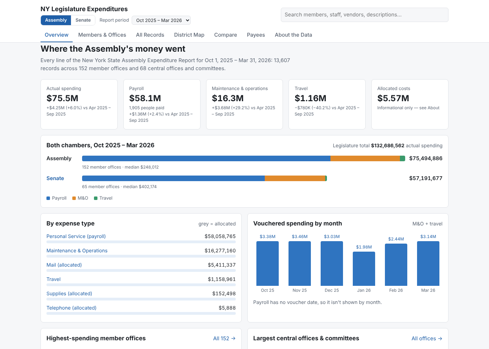
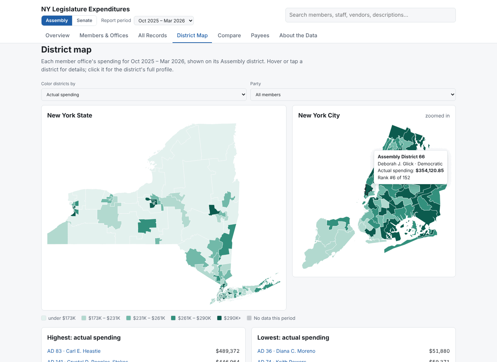
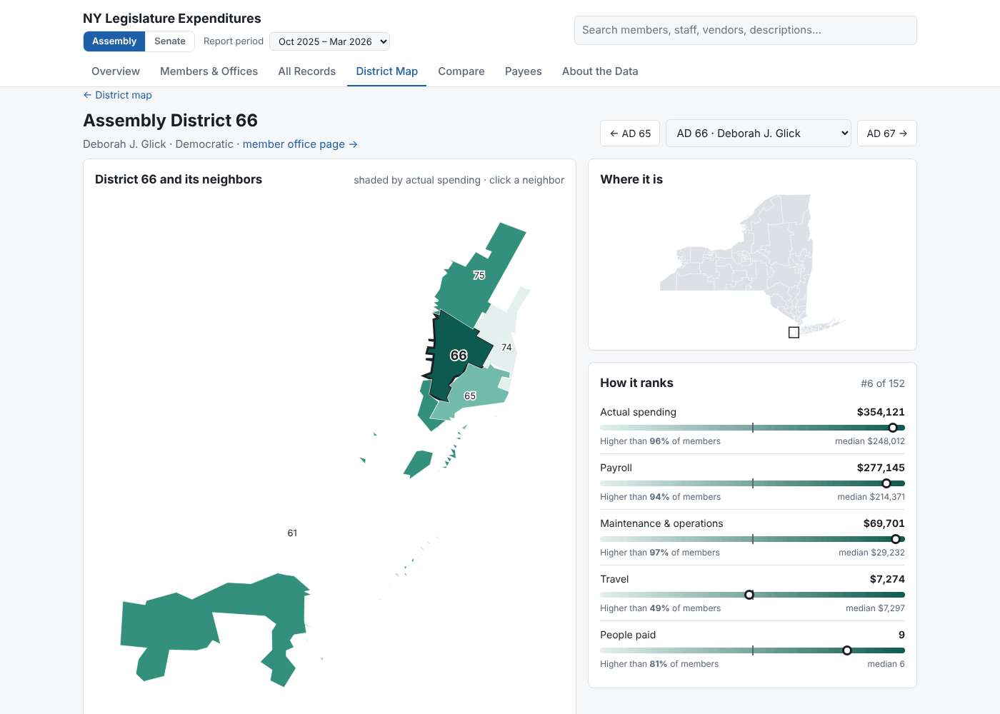
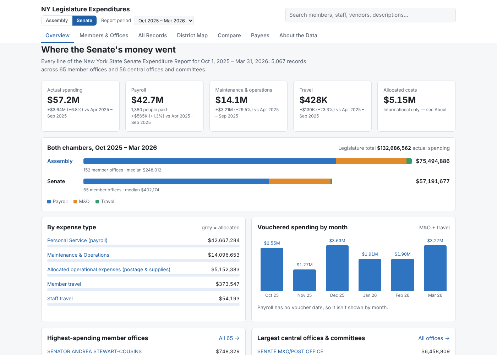
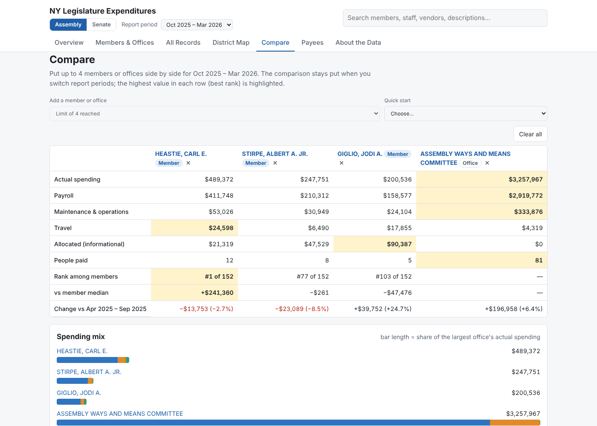
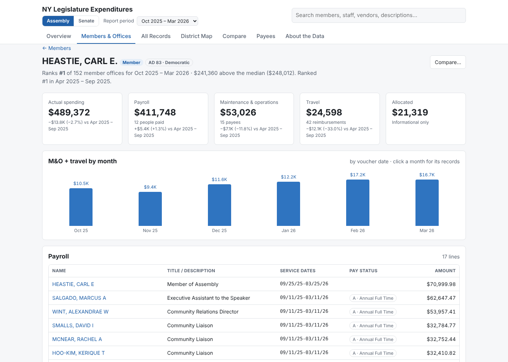
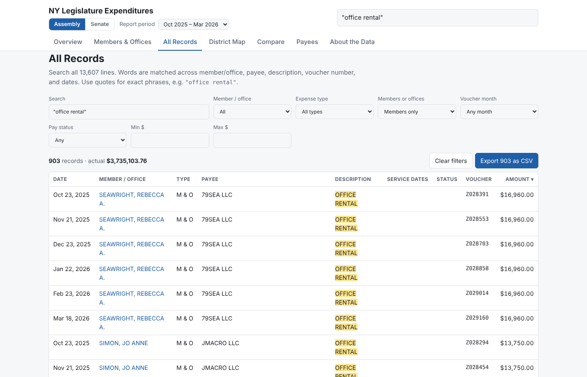
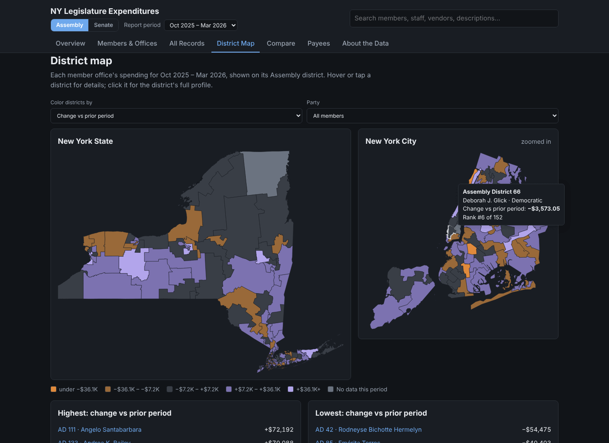

<p align="center">
  
</p>

<p align="center">
  <a href="https://rike4545.github.io/NYS-Assembly-Expenditures/"><strong>Open the live site →</strong></a>
</p>

<p align="center">
  <a href="https://github.com/rike4545/NYS-Assembly-Expenditures/actions/workflows/pages.yml"></a>
  
  
  
  
  
</p>

---

The New York State Assembly and Senate each publish their spending twice a year: tens of thousands of lines of payroll, rent, utilities, travel and vendor payments. This project turns both chambers' reports into one fast, searchable website where anyone can see **where the money went, who it went to, and how each office and district compares**.

## Highlights from the data

**Actual spending** = payroll + maintenance & operations + travel. Allocated postage/supplies/mail costs are tracked separately, since both chambers describe them as informational shares of centrally paid costs.

| | Apr – Sep 2025 | Oct 2025 – Mar 2026 | Change |
|---|---:|---:|---:|
| **Legislature, actual spending** | $124.79M | $132.69M | +6.3% |
| Assembly | $71.24M | $75.49M | +6.0% |
| Senate | $53.55M | $57.19M | +6.8% |
| Median Assembly member office | $243,517 | $248,012 | +1.8% |
| Median Senate member office | $412,552 | $402,174 | −2.5% |

| Oct 2025 – Mar 2026 | Payroll | Maintenance & operations | Travel |
|---|---:|---:|---:|
| Assembly | $58.06M | $16.28M | $1.16M |
| Senate | $42.67M | $14.10M | $0.43M |

## A tour

<table>
  <tr>
    <td width="50%"><br><sub><b>Overview</b> — switch between Assembly and Senate; totals with change from the prior report, both chambers side by side, spending by type and month, top offices, vendors and purposes.</sub></td>
    <td width="50%"><br><sub><b>District map</b> — all 150 Assembly or 63 Senate districts shaded by spending, payroll, operations, travel, headcount or change, with a zoomed NYC panel and party filter.</sub></td>
  </tr>
  <tr>
    <td width="50%"><br><sub><b>District profiles</b> — zoomed map of a district and its neighbors, percentile gauges against every member office, spending mix, neighbor comparison, period trend and monthly spending. Step through with ← →.</sub></td>
    <td width="50%"><br><sub><b>Senate</b> — every view works for either chamber; the header toggle keeps your period and view.</sub></td>
  </tr>
  <tr>
    <td width="50%"><br><sub><b>Compare</b> — up to four members or offices side by side: totals, rank, distance from the median, spending mix, monthly spending on a shared scale.</sub></td>
    <td width="50%"><br><sub><b>Member pages</b> — rank now and last period, every staff payroll line with title and pay status, vendors, purposes, monthly spending and travel.</sub></td>
  </tr>
  <tr>
    <td width="50%"><br><sub><b>All records</b> — full-text search across every line with exact phrases, filters for office, type, month, pay status and amount, and CSV export of exactly what you filtered.</sub></td>
    <td width="50%"><br><sub><b>Light and dark</b> — follows your system theme; works on phones too.</sub></td>
  </tr>
</table>

## Features

- 🏛️ **Both chambers** — Assembly and Senate, same views, one toggle.
- 🔎 **Search everything** — 38,342 lines across four reports; quoted phrases, highlighted matches.
- 🗓️ **Switch report periods** — every view follows; member pages and comparisons carry across by name.
- 📈 **Change over time** — period-over-period change on totals, members, maps and comparisons.
- 🗺️ **District maps** — 2024 Assembly and Senate lines, NYC inset, keyboard and touch friendly.
- 📍 **District profiles** — pick any district (menu, map click, or ← → keys): zoomed map with neighbors, percentile gauges, spending mix, neighbor comparison, period trend and monthly spending.
- ⚖️ **Side-by-side comparison** — up to four members or offices.
- 🔗 **Shareable links** — every chamber, period, search, filter and view lives in the URL.
- ⬇️ **CSV export** — of member tables and filtered records.
- 🪶 **No build step, no dependencies** — plain HTML, CSS and JavaScript; Python only to prepare data.

## Data sources

| Source | Used for |
|---|---|
| [NYS Assembly Expenditure Reports](https://assembly.ny.gov/expenditure/) | Every Assembly spending line (`data/raw/assembly/`, unmodified) |
| [NYS Senate Open Data — Expenditure Reports](https://www.nysenate.gov/open-data) | Every Senate spending line (`data/raw/senate/`, unmodified) |
| NYS ITS Geospatial Services — [Assembly](https://gisservices.its.ny.gov/arcgis/rest/services/NYS_Assembly_Districts/MapServer) and [Senate](https://gisservices.its.ny.gov/arcgis/rest/services/NYS_Senate_Districts/MapServer) Districts | District boundaries (2024 lines), member names and party |

| Chamber | Period | Source file | Lines | Actual spending | Allocated |
|---|---|---|---:|---:|---:|
| Assembly | Oct 1, 2025 – Mar 31, 2026 | `cad00251-20260331.csv` | 13,607 | $75,494,885.73 | $5,569,722.57 |
| Assembly | Apr 1, 2025 – Sep 30, 2025 | `674cb5b2-20250930.csv` | 14,742 | $71,242,039.20 | $2,664,899.24 |
| Senate | Oct 1, 2025 – Mar 31, 2026 | `nysenate_expenditures_20260331.csv` | 5,067 | $57,191,676.63 | $5,152,383.10 |
| Senate | Apr 1, 2025 – Sep 30, 2025 | `nysenate_expenditures_20250930.csv` | 4,926 | $53,547,054.14 | $1,932,370.88 |

### How the data is treated

- **Nothing is added or removed.** Every line in each report appears on the site; totals are reproducible from the raw CSVs.
- **One layout for both chambers.** Each expense type is grouped as payroll, operations, travel (Senate member + staff travel combined) or allocated, so the chambers compare like for like.
- **Allocated costs are kept separate** from actual spending (see above).
- **Member offices** are offices whose payroll includes the member's salary line ("MEMBER OF ASSEMBLY" / "MEMBER"), so members who joined or left mid-period are included.
- **Assembly voucher dates** have no year in the source; the year comes from the report period. **Senate voucher numbers** are taken from the end of each description.
- **Senate pay types** (RA, SA, TE, VA) are shown as published; the report doesn't define them.
- **Period comparisons** match members and offices by name as printed in each report.
- **Districts** are matched to report names by last name (`scripts/build_districts.py`; two Assembly matches set by hand and documented there). The GIS layers list current members, so members who left earlier have no district shading; Senate District 12 is listed as vacant.

## Run it locally

```bash
python3 scripts/build_data.py        # data/raw/{assembly,senate}/*.csv -> data/<chamber>/periods/*.json
python3 scripts/build_districts.py   # match districts to member offices
python3 -m http.server 8000          # open http://localhost:8000
```

Want a single file you can email or open from disk?

```bash
python3 scripts/build_standalone.py dist/ny-legislature-expenditures.html
```

## Adding a new report

1. Download the new CSV into `data/raw/assembly/` (from [assembly.ny.gov/expenditure](https://assembly.ny.gov/expenditure/)) or `data/raw/senate/` (from [nysenate.gov/open-data](https://www.nysenate.gov/open-data)), keeping the `YYYYMMDD.csv` end-date suffix (`0331` or `0930`).
2. Run the two build scripts and commit. The new period shows up in the switcher, and GitHub Pages redeploys on push.

## Project layout

```
index.html                    Page shell
assets/app.js                 All interactivity (vanilla JS, hash routing, SVG maps)
assets/styles.css             Styles, light and dark
data/raw/{assembly,senate}/   Original expenditure CSVs, unmodified
data/chambers.json            Chambers and their reporting periods
data/<chamber>/periods/*.json Compact, dictionary-encoded data per report
data/<chamber>/districts.json Districts matched to member offices
data/geo/                     District boundaries (NYS GIS), unmodified downloads
scripts/build_data.py         CSV -> JSON for both chambers, with validation
scripts/build_districts.py    District/member matching
scripts/build_standalone.py   One-file HTML bundle
docs/                         README images and link-preview image
.github/workflows/pages.yml   Builds and deploys to GitHub Pages on push to main
```

## Publishing

The site deploys to GitHub Pages from `.github/workflows/pages.yml` on every push to `main`. For a nicer link preview on social media, upload `docs/social-preview.png` under **Settings → General → Social preview**.

---

<sub>Independent presentation of public records. Not affiliated with or endorsed by the New York State Assembly or Senate.</sub>
