<p align="center">
  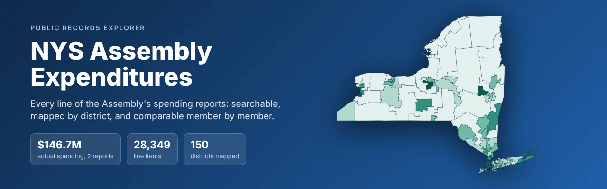
</p>

<p align="center">
  <a href="https://rike4545.github.io/NY-Legislature-Expenditures/"><strong>Open the live site →</strong></a>
</p>

<p align="center">
  <a href="https://github.com/rike4545/NY-Legislature-Expenditures/actions/workflows/pages.yml"></a>
  
   
  
  
  
</p>

---

**How does your Assembly member's office spend its budget? Who's on the payroll, which vendors get paid, and how does that compare with the office next door?**

Twice a year, the New York State Assembly and Senate each publish an Expenditure Report: every paycheck, rent payment, vendor bill and travel reimbursement for six months. Together that's tens of thousands of lines in spreadsheets few people ever open. This site puts both chambers' reports in one place, so anyone can search them, map them by district and compare offices side by side, without doing the math.

It's built for voters, reporters, civic groups and legislative staff. Every number links back to the public record it came from.

## Disclosures

- **No outside funding.** No donations, grants, advertising or sponsorships.
- **No endorsements.** The site doesn't support or oppose any candidate, party, ballot measure or bill, and no one endorses it.
- **Independent.** Not affiliated with the Assembly, the Senate or any state agency.
- **Public records only.** Every figure comes from a source listed [below](#data-sources).
- **Corrections welcome.** Spot a mistake? [Open an issue](https://github.com/rike4545/NY-Legislature-Expenditures/issues).

## What the latest reports show

**Actual spending** means payroll, office expenses (maintenance & operations) and travel. Each office's share of centrally paid postage, supplies and mail is counted separately as **allocated** costs, because both chambers say those figures are for information only.

| | Apr – Sep 2025 | Oct 2025 – Mar 2026 | Change |
|---|---:|---:|---:|
| **Legislature, actual spending** | $124.79M | $132.69M | +6.3% |
| Assembly | $71.24M | $75.49M | +6.0% |
| Senate | $53.55M | $57.19M | +6.8% |
| Typical Assembly member office | $243,517 | $248,012 | +1.8% |
| Typical Senate member office | $412,552 | $402,174 | −2.5% |

"Typical" is the median: half of offices spent more, half spent less.

| Oct 2025 – Mar 2026 | Payroll | Office expenses | Travel |
|---|---:|---:|---:|
| Assembly | $58.06M | $16.28M | $1.16M |
| Senate | $42.67M | $14.10M | $0.43M |

Payroll is about three-quarters of what each chamber spends.

## A quick tour

<table>
  <tr>
    <td width="50%">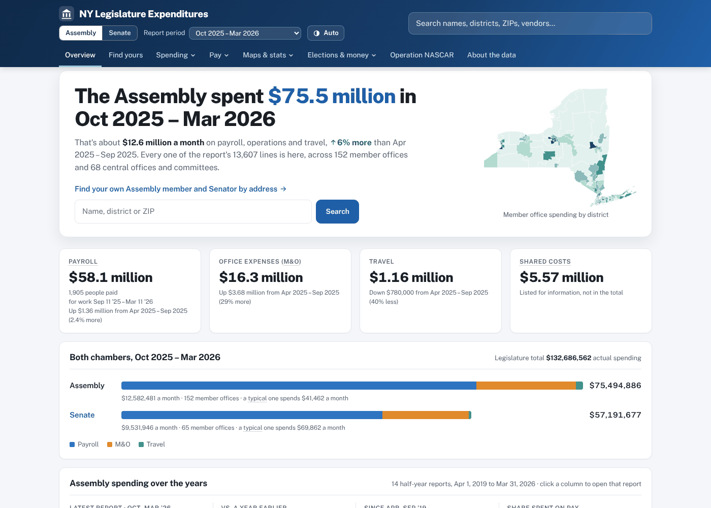<br><sub><b>Overview</b>: the chamber's total and how it changed since the last report, both chambers side by side, and the top offices, vendors and purposes.</sub></td>
    <td width="50%">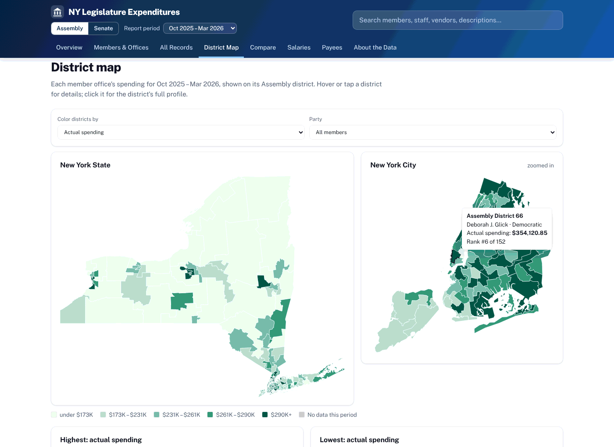<br><sub><b>District map</b>: all 150 Assembly or 63 Senate districts shaded by spending, payroll, office costs, travel, staff count or change, with a close-up of New York City.</sub></td>
  </tr>
  <tr>
    <td width="50%">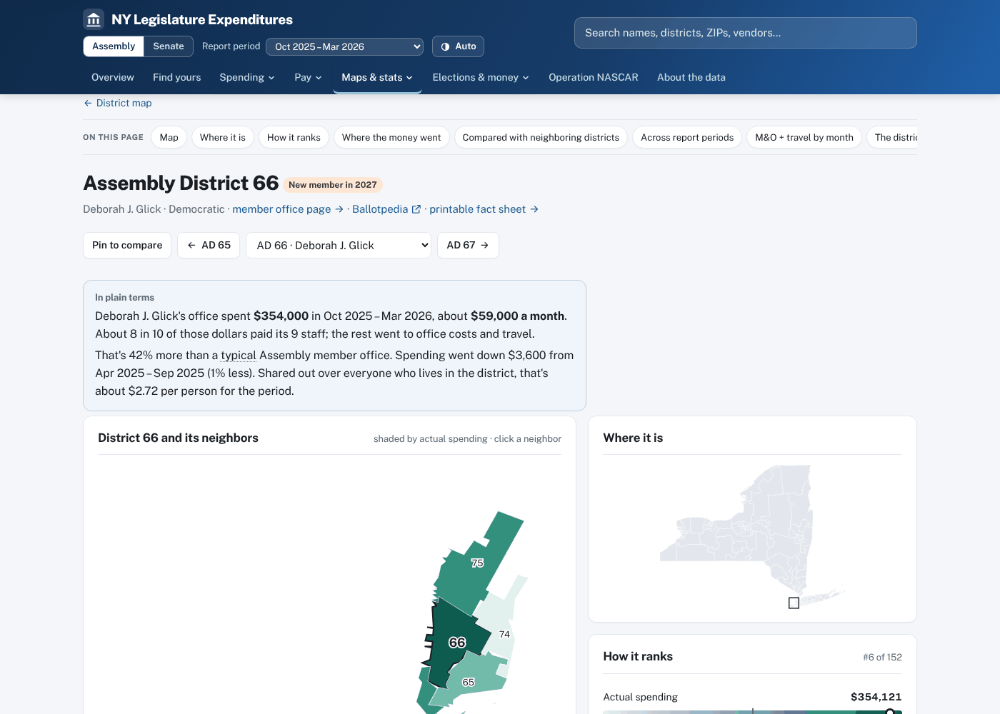<br><sub><b>District profiles</b>: how a district's office ranks against every other, what it spends money on, and how it compares with its neighbors. Use ← → to step through districts.</sub></td>
    <td width="50%">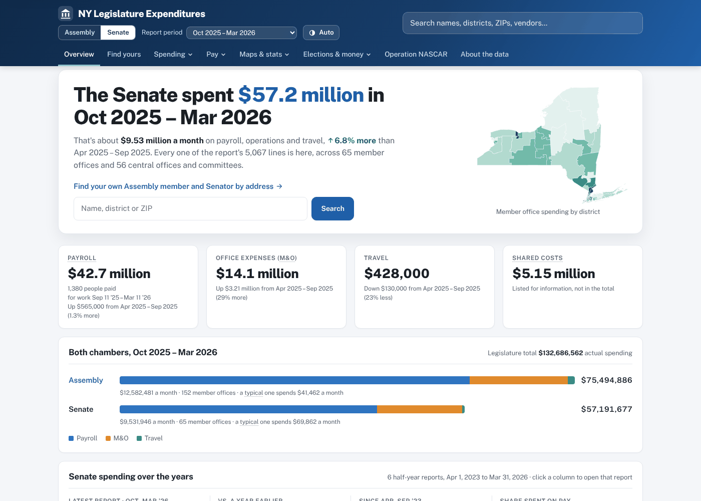<br><sub><b>Senate</b>: every view works for either chamber. Switching keeps your place.</sub></td>
  </tr>
  <tr>
    <td width="50%">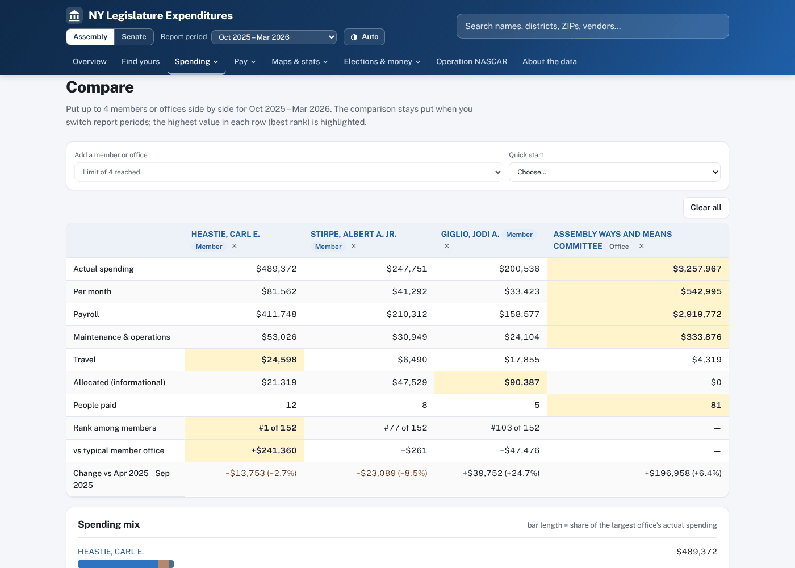<br><sub><b>Compare</b>: up to four members or offices side by side, with totals, rank, distance from typical, and monthly spending on one scale.</sub></td>
    <td width="50%">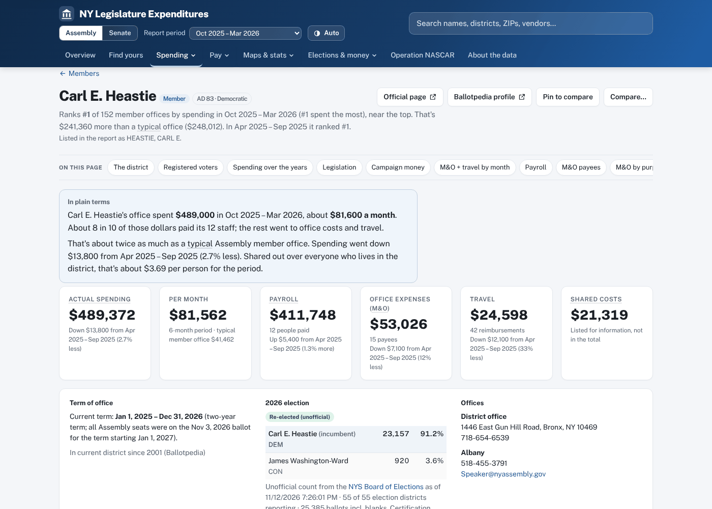<br><sub><b>Member pages</b>: rank this period and last, every staff payroll line with title and pay status, vendors, monthly spending and travel.</sub></td>
  </tr>
  <tr>
    <td width="50%">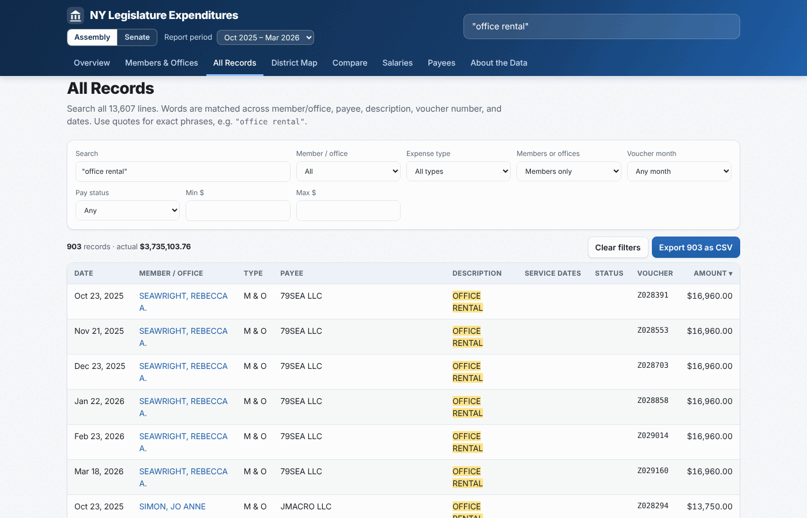<br><sub><b>All records</b>: search every line, filter by office, type, month, pay status or amount, and download exactly what you filtered as a CSV.</sub></td>
    <td width="50%">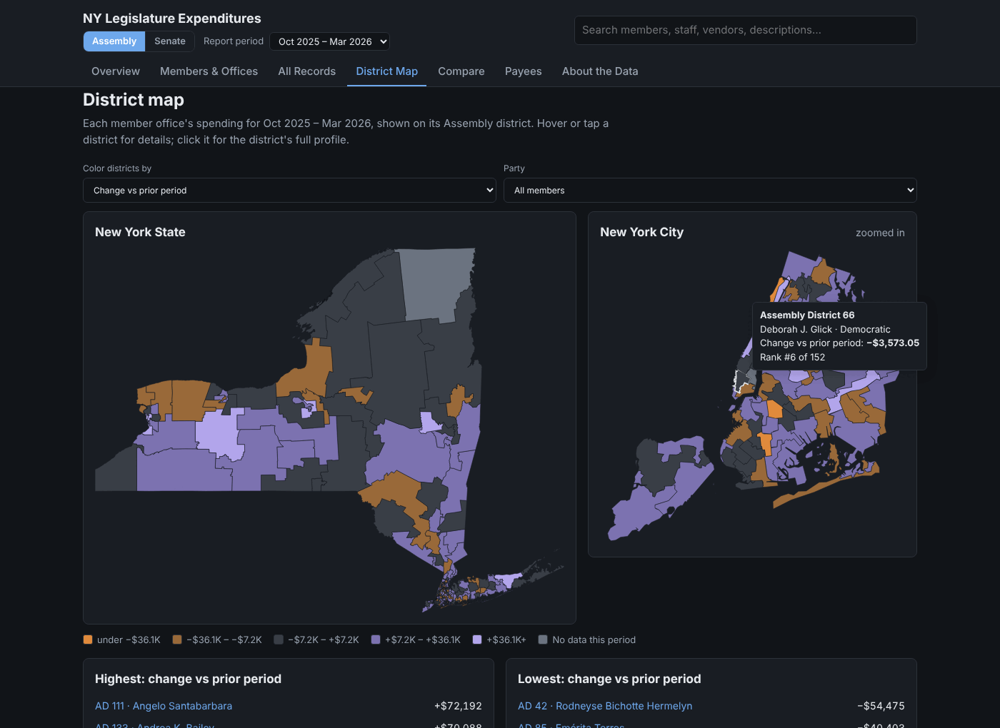<br><sub><b>Light and dark</b>: follows your device's theme and works on phones.</sub></td>
  </tr>
  <tr>
    <td width="50%">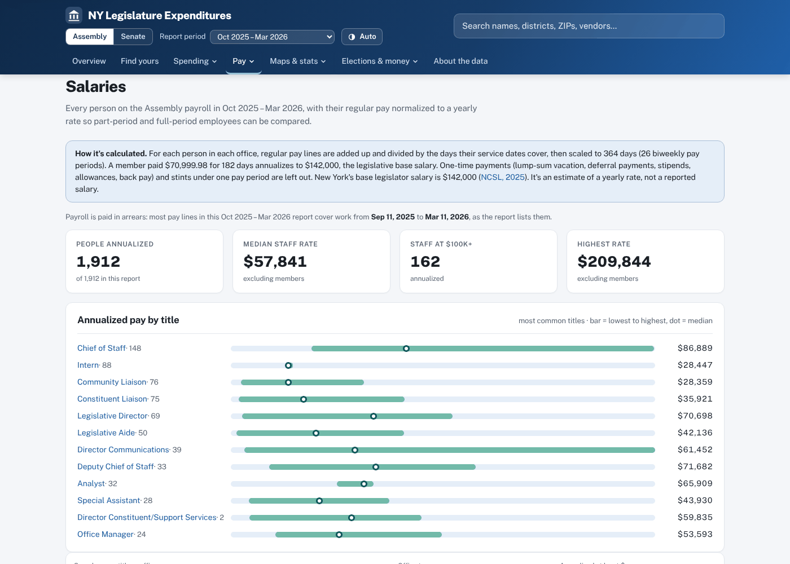<br><sub><b>Salaries</b>: everyone's regular pay turned into a yearly rate, with pay ranges by job title.</sub></td>
    <td width="50%">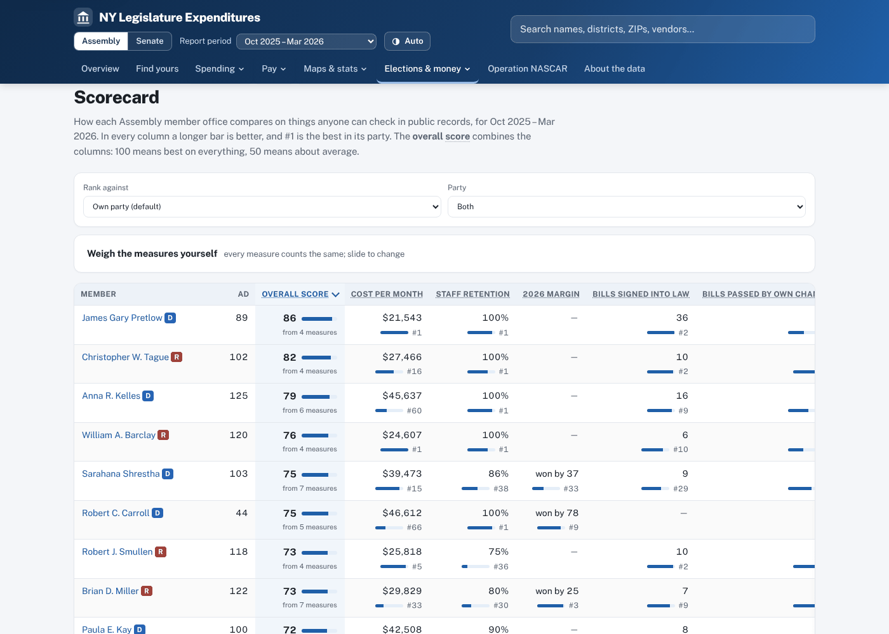<br><sub><b>Scorecard</b>: every member office ranked on cost, staff turnover, election margin and lawmaking, within its party or the whole chamber. Sliders let you decide what matters most.</sub></td>
  </tr>
</table>

## What's on the site

**Start here**
- 🏠 **Find yours.** Enter an address to get your Assembly member and State Senator, what their offices spend, how their 2026 races went and who funds their campaigns.
- 🔎 **Search everything.** All 38,342 lines across four reports, plus names, districts, ZIP codes and vendors. Typos are forgiven; quotes match exact phrases.
- 🔗 **Share any view.** The chamber, period, search and filters all live in the link.

**Spending**
- 🏛️ **Both chambers, one toggle.** The Assembly and Senate use the same views and the same spending categories, so they compare like for like.
- 🗓️ **Report periods.** Switch periods and every page follows, including member pages and comparisons.
- 📈 **What changed.** Change since the last report on totals, members, maps and comparisons.
- 📅 **Cost per month.** Each office's spending per month it was open. Members who joined or left partway through are counted only for the months they served.
- 🤝 **Vendors that also donate.** Businesses the Legislature paid that also gave to Assembly or Senate candidates, flagged when a vendor gave to the member whose office paid it.
- ⬇️ **CSV downloads** of member tables and filtered records.

**Pay**
- 💵 **Salaries.** Everyone's regular pay as a yearly rate, searchable, with ranges by title. Example: a member paid $70,999.98 for 182 days works out to exactly $142,000, the legislative base salary.
- 📋 **Senate payroll history.** Every biweekly Senate payroll report published as a spreadsheet, 2010–2026, with each person's pay history.

**Maps and districts**
- 🗺️ **District maps** on the 2024 Assembly and Senate lines, with a New York City close-up. Keyboard and touch friendly.
- 📍 **District profiles.** Pick a district from the menu, click it on the map, or use ← →. Each has a printable fact sheet.

**Members, elections and money**
- 🧾 **Member profiles.** Term of office, district and Albany offices, leadership, committee and caucus posts, leadership pay, staff shared with other offices, and the 2026 result (unofficial, with sources).
- ✈️ **Senator trips.** Every trip in the Senate's member travel file (dates, destination, per diem, mileage, tolls, airfare), each matched to its payment in the expenditure report. The totals agree to the cent.
- 🚗 **Travel benchmarks.** The miles implied by each senator's mileage reimbursement at the IRS rate, shown next to the state's per diem rules and the Comptroller's travel manual.
- 🗳️ **Donations, outside money and public matching funds** by district and candidate. Money is shown by type and size of donor, never by individual donor's name.
- 🏷️ **Party endorsements.** The ballot lines each candidate ran on in November.
- 📊 **Scorecard** and **Statistics** for comparing offices across the chamber.
- 🔗 **Ballotpedia links** for every current member, and a link to each member's 2025 financial disclosure statement where one is posted.

**For district offices**
- 🏁 **Operation NASCAR.** A constituent-services playbook for any district office (it opens on Senate District 1): district facts, office contacts, a 30-day, 90-day, quarterly and yearly checklist, response standards, a communications plan, eight sample constituent letters with the office's details filled in, casework categories with the right state agency for each, and the district's ZIP codes. Checklist progress and letter edits save in your browser, and the whole thing prints. Link: `#/nascar?c=senate&d=1`

**Under the hood**
- 🪶 **No build step and no dependencies.** Plain HTML, CSS and JavaScript. Python is used only to prepare the data.

## Design

The site's look and writing rules live in [`DESIGN.md`](DESIGN.md), written in the [DESIGN.md format](https://getdesign.md/what-is-design-md) used by Claude Design and similar tools. Colour, type, spacing and component tokens come first, then the reasons behind them. It also sets the rules that keep the site trustworthy and easy to read: a source under every chart, bars that start at zero, amounts in words, "typical" instead of "median", and no individual donor names. To change the look, change the tokens there first, then the CSS.

## Data sources

| Source | Used for |
|---|---|
| [NYS Assembly Expenditure Reports](https://assembly.ny.gov/expenditure/) | Every Assembly spending line (`data/raw/assembly/`, unmodified) |
| [Assembly Expenditure Reports, 2019–2025](https://nyassembly.gov/expenditure/) | Spending over the years (`data/raw/assembly/history/`, `scripts/build_history.py`) |
| [NYS Senate Open Data: Expenditure Reports](https://www.nysenate.gov/open-data) | Every Senate spending line, the per-trip member travel detail, and the biweekly payroll reports (`data/raw/senate/`, unmodified) |
| [NYS Comptroller Travel Manual](https://www.osc.ny.gov/files/state-agencies/travel/pdf/agencies-travel-manual-attachment.pdf), [IRS mileage rates](https://www.irs.gov/newsroom/irs-sets-2026-business-standard-mileage-rate-at-725-cents-per-mile-up-25-cents) | Travel rules and benchmarks on the About page; implied miles |
| [City & State](https://www.cityandstateny.com/politics/2026/11/where-do-all-key-new-york-state-legislative-races-stand/417054/), [Greenberg Traurig](https://www.gtlaw.com/-/media/files/insights/alerts/2026/11/gt-alert_new-york-state-2026-election-update.pdf), Wikipedia | 2026 election outcomes for each seat (`data/elections/`, unofficial) |
| [nyassembly.gov committees](https://nyassembly.gov/comm/), Wikipedia | Current leadership, committee and caucus posts (`data/roles/`) |
| [Ballotpedia](https://ballotpedia.org/Main_Page): current [Assembly](https://ballotpedia.org/New_York_State_Assembly) and [Senate](https://ballotpedia.org/New_York_State_Senate) members | Profile links for each member (`data/ballotpedia/`, retrieved 2026-11-12) |
| [NYS Board of Elections: enrollment by Assembly and Senate district](https://elections.ny.gov/enrollment-assembly-district), Nov 1, 2026 | Registered voters (active, inactive and by party) and turnout per district (`data/raw/elections/`, `scripts/build_enrollment.py`) |
| [NYS Board of Elections: Public Campaign Finance candidate list](https://publicreporting.elections.ny.gov/PCFBCandidateRegList/PCFBCandidateRegList), 2026 | Which candidates took part in public financing, their status and the matching funds they received; also ties committees to candidates (`scripts/build_public_financing.py`) |
| [State Board of Elections: expenditures (schedule F)](https://data.ny.gov/d/ajsb-8pni), with the Senate payroll and Assembly expenditure reports | Campaign staff: people each candidate's committees paid for campaign work in 2025–26, and whether they're also on a legislative payroll, matched by name (`scripts/build_campaign_staff.py`) |
| [State Board of Elections: independent expenditures](https://publicreporting.elections.ny.gov/IESchedRSupportOppose/IESchedRSupportOppose) | Outside money for and against candidates (`scripts/build_outside_money.py`) |
| [State Board of Elections: 2026 contribution limits](https://elections.ny.gov/contribution-limits) | Per-donor and family limits by district (`scripts/build_limits.py`) |
| [State ethics commission (COELIG): financial disclosure statements](https://ethics.ny.gov/financial-disclosure-statements-elected-officials) | A link to each member's 2025 annual financial disclosure statement; 177 of 212 sitting members so far (`data/raw/disclosures/fds_2025_links.tsv`, attached by `scripts/build_members.py`) |
| [Lobbyist Bi-Monthly Reports](https://data.ny.gov/d/t9kf-dqbc) (COELIG) | Organizations that reported lobbying each legislator in 2025–26 (`scripts/fetch_lobbying.py`, `scripts/build_lobbying.py`) |
| [NY Open Legislation](https://legislation.nysenate.gov) | Bills each member sponsored in the 2025–26 session and how far they got, compared with their prior terms and with the district's previous member (2017–18 to 2023–24, fetched once by `.github/workflows/legislation-history.yml`). `scripts/fetch_legislation.py` needs a free API key in `NYSENATE_API_KEY`; then `scripts/build_legislation.py` |
| NYS ITS Geospatial Services: [Assembly](https://gisservices.its.ny.gov/arcgis/rest/services/NYS_Assembly_Districts/MapServer) and [Senate](https://gisservices.its.ny.gov/arcgis/rest/services/NYS_Senate_Districts/MapServer) districts | District boundaries (2024 lines), member names and party |
| [NYS GIS district boundaries](https://gis.ny.gov) | Which Senate districts overlap each Assembly district, and the reverse, by share of land area (`scripts/build_district_overlap.py`, needs `shapely`) |

### Reports on the site

| Chamber | Period | Source file | Lines | Actual spending | Allocated |
|---|---|---|---:|---:|---:|
| Assembly | Oct 1, 2025 – Mar 31, 2026 | `cad00251-20260331.csv` | 13,607 | $75,494,885.73 | $5,569,722.57 |
| Assembly | Apr 1, 2025 – Sep 30, 2025 | `674cb5b2-20250930.csv` | 14,742 | $71,242,039.20 | $2,664,899.24 |
| Senate | Oct 1, 2025 – Mar 31, 2026 | `nysenate_expenditures_20260331.csv` | 5,067 | $57,191,676.63 | $5,152,383.10 |
| Senate | Apr 1, 2025 – Sep 30, 2025 | `nysenate_expenditures_20250930.csv` | 4,926 | $53,547,054.14 | $1,932,370.88 |

### How the data is handled

- **Nothing is added or removed.** Every line of every report is on the site, and every total can be rebuilt from the raw CSVs.
- **One set of categories for both chambers.** Each expense type is grouped as payroll, office expenses, travel (for the Senate, member and staff travel combined) or allocated, so the chambers compare like for like.
- **Allocated costs are kept apart** from actual spending (see [above](#what-the-latest-reports-show)).
- **A member office** is any office whose payroll includes the member's own salary line ("MEMBER OF ASSEMBLY" or "MEMBER"). That way members who joined or left partway through a period are still counted.
- **Assembly voucher dates** don't include a year in the source, so the year comes from the report period. **Senate voucher numbers** come from the end of each line's description.
- **Senate trips** are tied to offices by matching each trip's check date and amount to a member travel voucher. Every trip matches exactly one voucher, and the trip totals equal the report's member travel ($497,462.48 and $373,547.12).
- **Yearly pay rates** add up each person's regular pay lines in an office, divide by the days their service dates cover, and scale to 364 days. One-time payments (lump sums, deferrals, stipends, allowances, back pay) and stints shorter than one pay period are left out. Most Senate member salary lines have no start date, so they aren't converted. These are estimated yearly rates, not reported salaries.
- **Cost per month** is actual spending divided by the months an office was active: the full six months, or the months covered by a member's own salary line if they served only part of the period.
- **Implied miles** are a trip's mileage reimbursement divided by the IRS business rate on the trip's start date (70¢ in 2025, 72.5¢ from Jan 1, 2026, and 76¢ from Jul 1, 2026). This gives a whole number of miles for about 95% of Senate trips.
- **Senate pay types** follow the Senate payroll reports: Regular Annual (RA), Special Annual (SA) and Temporary (TE, paid hourly). VA isn't defined there and is shown as published.
- **Period comparisons** match members and offices by their names as printed in each report.
- **Districts** are matched to report names by last name (`scripts/build_districts.py`; two Assembly matches are set by hand and documented there). The state's district map lists current members only, so members who left earlier have no district shading. Senate District 12 is listed as vacant.

## Keeping the data current

`.github/workflows/refresh.yml` runs every Monday morning and can be started any time from the Actions tab. It:

1. Pulls fresh campaign finance, public financing, outside money, legislation and lobbying data.
2. Checks for a new Assembly expenditure report, downloads it if there is one, and rebuilds that chamber's data.
3. Works out whether a new Senate payroll or expenditure report should be out by now. The Senate's site blocks automated downloads, so instead the workflow opens a GitHub issue asking for a hand download.
4. Commits whatever changed and redeploys the site.

The legislation step needs a repository secret named `NYSENATE_API_KEY` (Settings → Secrets and variables → Actions).

## Run it locally

```bash
python3 scripts/build_data.py        # data/raw/{assembly,senate}/*.csv -> data/<chamber>/periods/*.json
python3 scripts/build_districts.py   # match districts to member offices
python3 scripts/build_ballotpedia.py # attach Ballotpedia profile links
python3 scripts/build_members.py     # offices, posts, terms and 2026 result for each member
python3 -m http.server 8000          # then open http://localhost:8000
```

Want one file you can email or open straight from disk?

```bash
python3 scripts/build_standalone.py dist/ny-legislature-expenditures.html
```

## Adding a new report

1. Download the new CSV into `data/raw/assembly/` (from [assembly.ny.gov/expenditure](https://assembly.ny.gov/expenditure/)) or `data/raw/senate/` (from [nysenate.gov/open-data](https://www.nysenate.gov/open-data)). Keep the period end date at the end of the file name: `YYYYMMDD.csv`, ending in `0331` or `0930`.
2. Run the four build scripts above and commit. The new period appears in the report-period menu, and GitHub Pages redeploys on push.

New Assembly reports are usually picked up automatically by the weekly refresh.

## Project layout

```
index.html                    Page shell
assets/app.js                 All interactivity (vanilla JS, hash routing, SVG maps)
assets/styles.css             Styles, light and dark
DESIGN.md                     Design tokens, components and writing rules
data/raw/                     Original source files, unmodified
data/chambers.json            Chambers and their report periods
data/<chamber>/periods/*.json Compact data for each report
data/<chamber>/*.json         Districts, members, donations, legislation, lobbying and more
data/senate/travel/*.json     Senate trips matched to member offices
data/geo/                     District boundaries and ZIP lookups
scripts/build_*.py            Turn raw sources into the site's data files
scripts/fetch_*.py            Download sources that change often
scripts/check_new_reports.py  Look for new expenditure and payroll reports
scripts/build_standalone.py   One-file HTML bundle
docs/                         README images and link-preview image
.github/workflows/            Deploy, weekly refresh, legislation history and code scanning
```

## Publishing

The site deploys to GitHub Pages from `.github/workflows/pages.yml` on every push to `main`. For a better link preview on social media, upload `docs/social-preview.png` under **Settings → General → Social preview**.

---

<sub>An independent presentation of public records. Not affiliated with or endorsed by the New York State Assembly or Senate.</sub>
